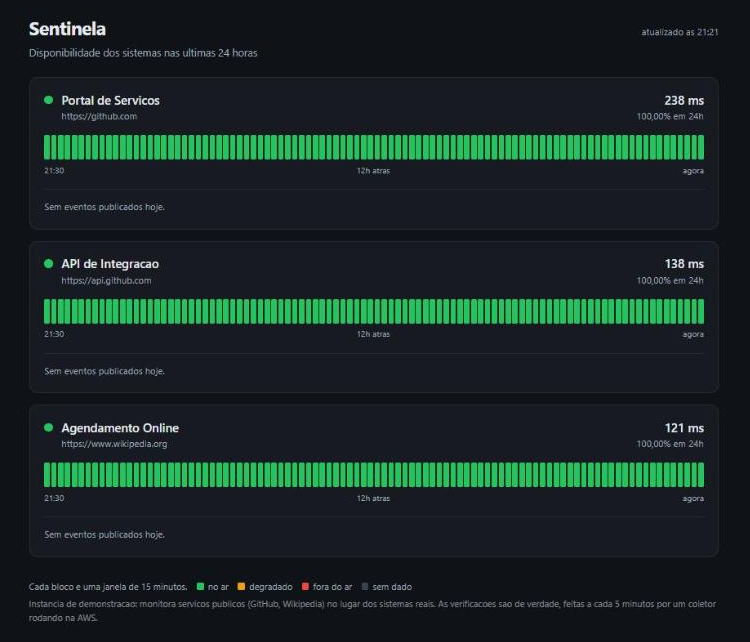

# Gustavo Almeida

**Software Engineer** · Python, Go & AWS · IA aplicada, APIs e automação / Applied AI, APIs and Automation

🌍 São Paulo, Brasil · Inglês fluente / Fluent English · Aberto a vagas remotas / Open to remote roles

---

<h2> Português</h2>

Sou **Software Engineer** e construo sistemas que resolvem problemas operacionais reais em escala: orquestração de processos, integração de sistemas e APIs. A maior parte do que eu construo substitui algo que antes era feito à mão.

Software Engineer na **Universidade Brasil**, onde construo plataformas internas para as operações acadêmica, financeira e de TI. Bacharelado em Ciência da Computação na **UNICID** (dezembro de 2026).

**Projetos em destaque** (detalhes, GIFs e demos no [portfólio](https://gualmeidap.github.io/)):

- 🧾 [**Portal Notas**](https://github.com/gualmeidap/portal-notas-demo): automação de faturas de fornecedores, em produção diária (~50 notas por mês). [Demo ao vivo](https://gualmeidap.github.io/portal-notas-demo/)
- 🔐 [**Portal TI**](https://github.com/gualmeidap/portal-ti-o365-demo): governança de acesso entre Microsoft 365, Active Directory e um ERP. [Demo ao vivo](https://gualmeidap.github.io/portal-ti-o365-demo/)
- 🔨 [**Sentinela**](https://github.com/gualmeidap/sentinela): monitoramento de disponibilidade e de eventos de negócio na AWS, a custo zero [Painel ao vivo](https://ajswegtqzqq75cxnsidkrk4jxy0qqzjt.lambda-url.us-east-1.on.aws/)
- ✒️ **Portal de assinatura eletrônica** (em desenvolvimento) e 🔑 **autoatendimento de senha** (sistemas internos)

---

<h2> English</h2>

I'm a **Software Engineer** building systems that solve real operational problems at scale: process orchestration, systems integration and APIs. Most of what I build replaces something that used to be done by hand.

Software Engineer at **Universidade Brasil**, building internal platforms for academic, financial and IT operations. B.Sc. in Computer Science at **UNICID** (December 2026).

**Featured projects** (details, GIFs and demos in the [portfolio](https://gualmeidap.github.io/)):

- 🧾 [**Portal Notas**](https://github.com/gualmeidap/portal-notas-demo): supplier invoice automation, in daily production (~50 invoices a month). [Live demo](https://gualmeidap.github.io/portal-notas-demo/)
- 🔐 [**Portal TI**](https://github.com/gualmeidap/portal-ti-o365-demo): access governance across Microsoft 365, Active Directory and an ERP. [Live demo](https://gualmeidap.github.io/portal-ti-o365-demo/)
- 🔨 [**Sentinela**](https://github.com/gualmeidap/sentinela): availability and business-event monitoring on AWS, at zero cost [Live dashboard](https://ajswegtqzqq75cxnsidkrk4jxy0qqzjt.lambda-url.us-east-1.on.aws/)
- ✒️ **Electronic signature portal** (in development) and 🔑 **student password self-service** (internal systems)

  
   Sentinela: painel ao vivo na AWS · live dashboard on AWS

---

## 🛠 Stack

---

## 📊 GitHub

<table align="center">
  <tr valign="top">
    <td>
      
    </td>
    <td>
      
    </td>
  </tr>
</table>

  

