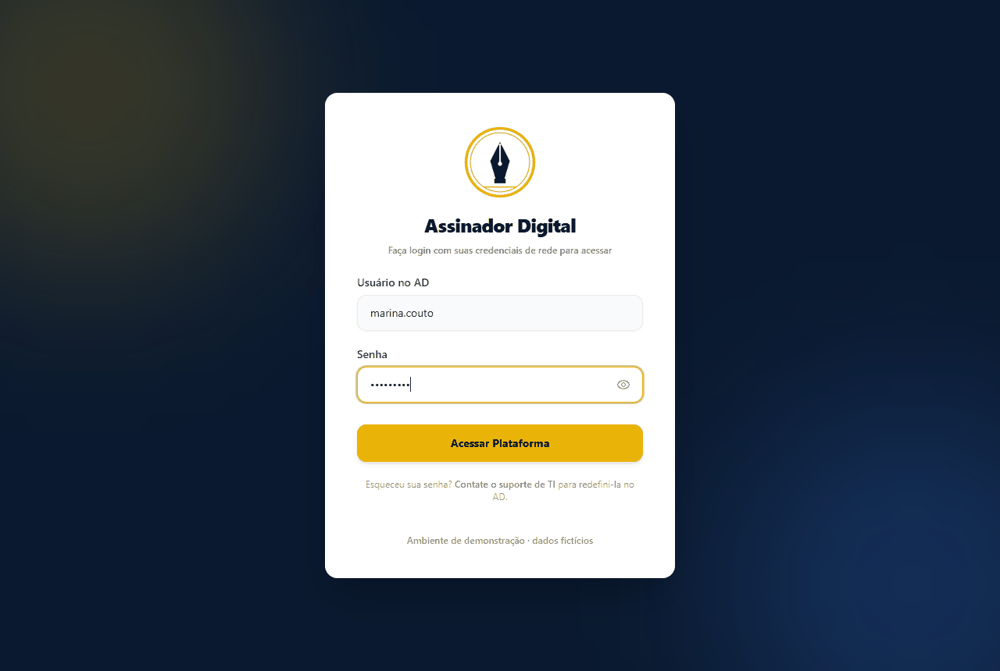
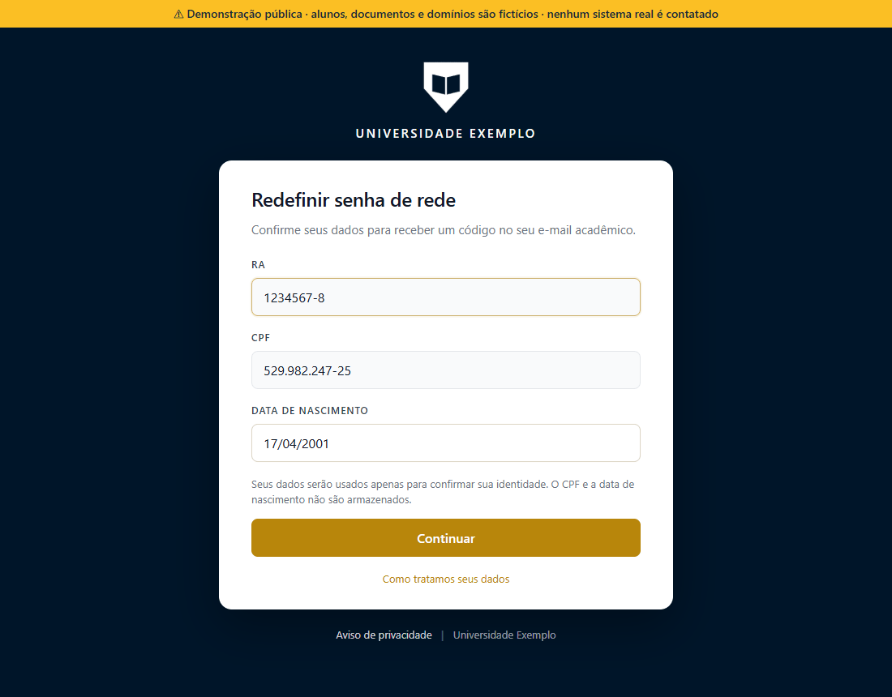

# Hey, I'm Gustavo Almeida 👋

**Back-end Developer** · Python & Java · Integrations, automation and APIs

🌍 **Open to remote roles** (US/EU companies) · English: advanced · São Paulo, Brazil

---

## About Me

I'm a **Back-end Developer** building systems that solve real operational problems at scale. My focus is process orchestration, systems integration, and APIs that are both performant and maintainable. I work close to infrastructure — from containerized deployments to integrating local LLMs into production workflows — always with an eye toward clean, purposeful engineering.

Most of what I build replaces something that used to be done by hand. Document pipelines that used to be manual reconciliation. User provisioning that used to be a support ticket. That's the thread across everything below.

- 🏢 Software Developer at **Universidade Brasil**, building internal platforms for academic, financial and IT operations
- 🎓 B.Sc. in Computer Science at **UNICID** — graduating 2026
- 🛠 4+ years in IT (technical support since 2022, software development since March 2026)
- 🔭 **Sentinela** — monitoring for system availability and business events (Java 21, Spring Boot, AWS Lambda/DynamoDB) — [live on AWS](https://github.com/gualmeidap/sentinela), 118 automated tests, CI on every push
- 🧠 Exploring local AI inference with **Ollama** for private, production-ready LLM integration
- 🐳 Strong believer in containerized, reproducible environments

---

## 🛠 Tech Stack

### Languages

### Frameworks & Libraries

### Data

### Infrastructure & Tools

### Practices

`REST APIs` · `JWT` · `Clean Code` · `SOLID` · `Layered Architecture` · `Async Processing`

---

## 🚀 Featured Projects

### 🧾 Tax Document Automation & Intelligent Extraction

> End-to-end back-end system that automates tax document workflows. The extraction engine reads, decrypts and reconciles invoices and payment slips from dozens of suppliers, backed by intelligent email tracking, automated archiving to SharePoint and an interactive management dashboard. Replaced a fully manual reconciliation process and shortened the purchase approval cycle. In production it handles about 30 suppliers a month (1–2 documents each).
>
> **Engineering focus:** low-confidence extractions are routed to a human review queue instead of being guessed — wrong data never silently enters the approval flow.

**Demo:** [Access Live System](https://api-notas-demo.onrender.com/) *(free tier — first load can take up to a minute)* · **Repository:** [api-notas-demo](https://github.com/gualmeidap/api-notas-demo)

`Python` · `FastAPI` · `Tesseract OCR` · `IMAP/SMTP` · `Microsoft Graph API` · `PostgreSQL` · `Docker`

---

### 🔐 User Provisioning Integration — Portal 365 × TOTVS RM

> Integration between the institutional portal and the TOTVS RM database for user account provisioning: creation, password reset and access blocking. Replaced a workflow that depended on manually opening a ticket with the IT department, with identity validation against academic records and handling of two distinct Active Directory domains.

**Demo:** [Access Live System](https://portal-ti-o365-demo.onrender.com/) *(free tier — first load can take up to a minute)* · **Repository:** [portal-ti-o365-demo](https://github.com/gualmeidap/portal-ti-o365-demo)

`Python` · `TOTVS RM` · `Active Directory / LDAP` · `SQL Server` · `REST APIs`

---

### ✒️ Electronic Signature Portal — DocuSeal × Active Directory

> Internal corporate portal that runs electronic signature workflows for HR, Finance and IT. Handles documents with any number of signers, optional strict ordering, deadlines and CC, pulling contacts straight from the institutional Active Directory. Signers never leave the platform — the DocuSeal widget opens inside the dashboard itself.
>
> **Engineering focus:** the dashboard updates itself. When a document is signed, DocuSeal fires an HMAC-SHA256 webhook at the Go back end, which pushes the change to every open screen over Server-Sent Events — no polling, and nobody reloads a page to find out whose turn it is.

**Source:** internal system — repository not public

`Go 1.24` · `React 19` · `PostgreSQL` · `Active Directory / LDAP` · `Server-Sent Events` · `Microsoft Graph API` · `Tailwind CSS`

---

### 🔑 Student Password Self-Service

> Lets a student reset their own Active Directory password without going through the registrar's office. Identity is validated as a block against academic records — student ID, national ID and date of birth — and a single-use 6-digit code then goes to the academic email address, valid for 15 minutes. The new password is checked against domain policy before the bind, and the account is unlocked in the same operation.
>
> **Engineering focus:** the response is identical whether the student ID exists or not, so the form can't be turned into an enrollment enumeration oracle. Rate limiting (3 per ID, 10 per IP every 30 minutes) is applied *before* any query reaches the ERP, so a flood never becomes database load.

**Source:** internal system — repository not public

`Python` · `Active Directory / LDAP` · `TOTVS RM` · `Microsoft Graph API`

---

## 🔨 Sentinela — Availability & Business Event Monitoring

> Dashboard that answers two questions instead of one: is each production system responding, and what did it actually do — how many password resets succeeded today, how many failed, and why. Uptime tools cover the first; only the monitored systems know what a "password reset" is.
>
> **Design constraint:** no personal data ever enters Sentinela — not masked on display, it never leaves the source system. Event types and failure reasons come from a closed vocabulary instead of raw log messages: raw messages eventually smuggle in a username, and they break grouping. "3 failures, all from the same unavailable dependency" is the useful answer; "3 failures" is not.

**Status:** running on AWS (collector every 5 min, API and dashboard on Lambda, DynamoDB), $0/month on the Always Free tier · 118 tests · GitHub Actions CI · **Repository:** [sentinela](https://github.com/gualmeidap/sentinela)

`Java 21` · `Spring Boot` · `AWS Lambda` · `DynamoDB` · `EventBridge` · `CloudFormation` · `GitHub Actions`

---

## 📊 GitHub Metrics

<table align="center">
  <tr valign="top">
    <td>
      
    </td>
    <td>
      
    </td>
  </tr>
</table>

---

### 📈 Contribution Activity Graph

  

---

*"First, solve the problem. Then, write the code."* — John Johnson

