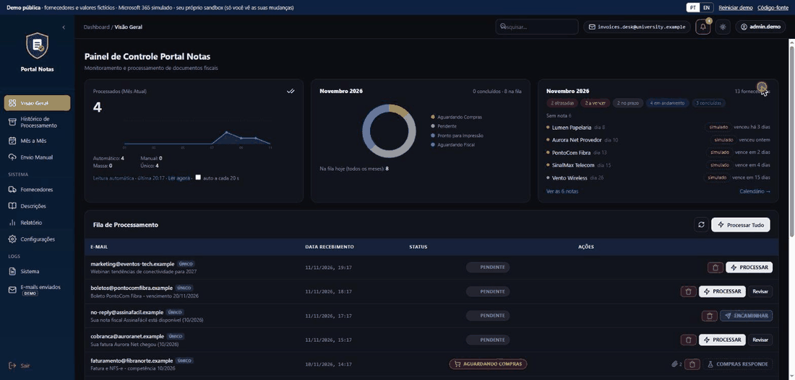
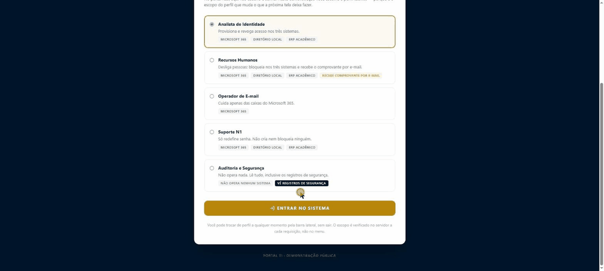
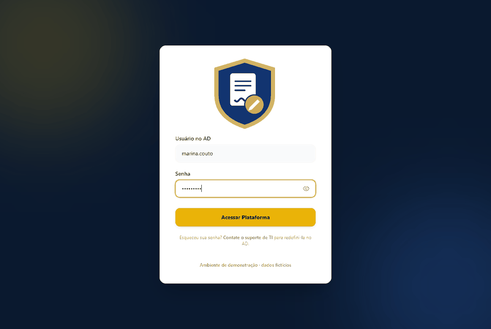
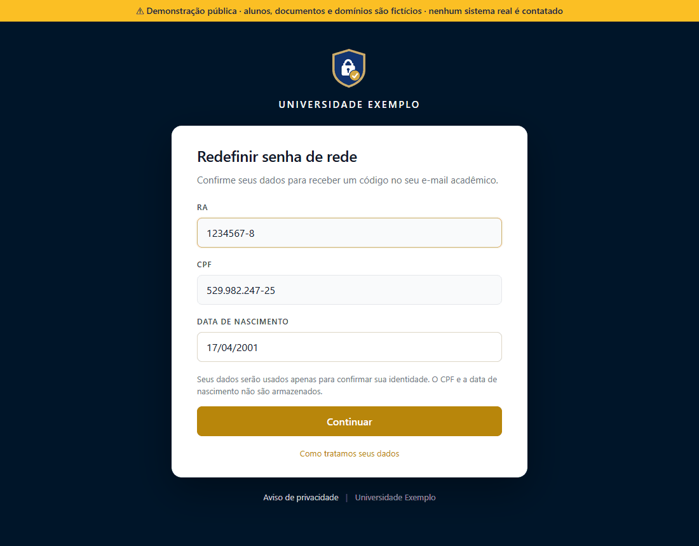

🇧🇷 **Português** · 🇺🇸 [English](README.md)

# Oi, eu sou o Gustavo Almeida 👋

**Software Engineer** · Python, Go e AWS · IA aplicada, APIs e automação

🌍 **Aberto a vagas remotas** (empresas dos EUA e da Europa) · Inglês: fluente · São Paulo, Brasil

---

## Sobre mim

Sou **Software Engineer** e construo sistemas que resolvem problemas operacionais reais em escala. Meu foco é orquestração de processos, integração de sistemas e APIs que sejam, ao mesmo tempo, performáticas e fáceis de manter. Trabalho perto da infraestrutura — de implantações em contêineres à integração de LLMs locais em fluxos de produção — sempre com atenção a uma engenharia limpa e com propósito.

A maior parte do que eu construo substitui algo que antes era feito à mão. Pipelines de documentos que antes eram conciliação manual. Provisionamento de usuários que antes era um chamado de suporte. Esse é o fio condutor de tudo abaixo.

- 🏢 Software Engineer na **Universidade Brasil**, construindo plataformas internas para as operações acadêmica, financeira e de TI
- 🎓 Bacharelado em Ciência da Computação na **UNICID** — formatura em dezembro de 2026
- 🛠 Mais de 4 anos em TI (analista de TI desde 2022, software engineer desde março de 2026)
- 🔭 **Sentinela** — monitoramento de disponibilidade e de eventos de negócio (Java 21, Spring Boot, AWS Lambda/DynamoDB) — [no ar na AWS](https://github.com/gualmeidap/sentinela), 118 testes automatizados, CI a cada push
- 🧠 Explorando inferência de IA local com o **Ollama** para integrar LLMs de forma privada e pronta para produção
- 🐳 Defensor de ambientes em contêineres e reproduzíveis

---

## 🛠 Stack

### Linguagens

### Frameworks e bibliotecas

### Dados

### Infraestrutura e ferramentas

### Práticas

`APIs REST` · `JWT` · `Clean Code` · `SOLID` · `Arquitetura em camadas` · `Processamento assíncrono`

---

## 🚀 Projetos em destaque

### 🧾 Portal Notas: automação de documentos fiscais e extração inteligente

> Sistema back-end ponta a ponta que automatiza o recebimento de faturas de fornecedores. As faturas chegam em caixas de e-mail compartilhadas (Microsoft Graph), passam por um fluxo de aprovação (Compras ou direto ao Fiscal), são extraídas com leitura de PDF, OCR e regras de fornecedor configuráveis, arquivadas no SharePoint, e o Financeiro recebe uma planilha consolidada. Substituiu uma conciliação totalmente manual e encurtou o ciclo de aprovação de compras. Em produção diária: cerca de **50 notas por mês de ~30 fornecedores**, com cerca de 85% menos trabalho manual (estimativa minha).
>
> **Foco de engenharia:** extrações com baixa confiança vão para uma fila de revisão humana em vez de serem adivinhadas — dado errado nunca entra em silêncio no fluxo de aprovação. Um LLM local só ajuda a cadastrar fornecedores novos, então as faturas nunca saem da rede.

**Demo:** [Abrir a demo ao vivo](https://gualmeidap.github.io/portal-notas-demo/) *(roda inteira no seu navegador, dados fictícios)* · **Repositório:** [portal-notas-demo](https://github.com/gualmeidap/portal-notas-demo)

`Python` · `FastAPI` · `Tesseract OCR` · `Microsoft Graph API` · `PostgreSQL` · `Redis` · `Docker` · `Prometheus` · `Grafana`

---

### 🔐 Portal TI: governança de acesso entre Microsoft 365, um diretório e um ERP

> Portal interno, construído do zero, que cria, redefine e bloqueia o acesso de uma pessoa em três sistemas com uma única ação: Microsoft 365, o Active Directory local e o ERP TOTVS RM. Substituiu um fluxo que dependia de abrir um chamado manualmente no departamento de TI, com validação de identidade contra o cadastro acadêmico e tratamento de dois domínios distintos do Active Directory.
>
> **Foco de engenharia:** escopos por perfil (TI local, TI Sede, RH), contas protegidas que se recusam a ser bloqueadas, fila de retentativa para provisionamentos que falham e trilha de auditoria completa. Produção e homologação rodam lado a lado.

**Demo:** [Abrir a demo ao vivo](https://gualmeidap.github.io/portal-ti-o365-demo/) *(roda inteira no seu navegador, dados fictícios)* · **Repositório:** [portal-ti-o365-demo](https://github.com/gualmeidap/portal-ti-o365-demo)

`Python` · `Flask` · `TOTVS RM` · `Active Directory / LDAP` · `SQL Server` · `APIs REST`

---

## 🔨 Sentinela — monitoramento de disponibilidade e de eventos de negócio

> Painel que responde a duas perguntas em vez de uma: cada sistema em produção está respondendo, e o que ele de fato fez — quantas redefinições de senha deram certo hoje, quantas falharam e por quê. As ferramentas de uptime cobrem a primeira; só os sistemas monitorados sabem o que é uma "redefinição de senha".
>
> **Restrição de projeto:** nenhum dado pessoal entra no Sentinela — não é mascarado na exibição, ele nunca sai do sistema de origem. Tipos de evento e motivos de falha vêm de um vocabulário fechado, e não de mensagens de log cruas: mensagem crua acaba carregando um nome de usuário e quebra o agrupamento. "3 falhas, todas pela mesma dependência indisponível" é a resposta útil; "3 falhas" não é.

**Situação:** rodando na AWS (coletor a cada 5 min, API e painel em Lambda, DynamoDB), US$ 0/mês no nível Always Free · 118 testes · CI no GitHub Actions · **Repositório:** [sentinela](https://github.com/gualmeidap/sentinela)

`Java 21` · `Spring Boot` · `AWS Lambda` · `DynamoDB` · `EventBridge` · `CloudFormation` · `GitHub Actions`

---

### ✒️ Portal de assinatura eletrônica (em desenvolvimento)

> Portal corporativo interno para RH, Financeiro e TI conduzirem fluxos de assinatura eletrônica. Trata documentos com qualquer número de signatários, ordem estrita opcional, prazos e cópia (CC), buscando os contatos direto no Active Directory institucional. O provedor de assinatura fica atrás de uma interface: Documenso self-hosted por padrão, DocuSeal como alternativa. Quem assina nunca sai da plataforma.
>
> **Foco de engenharia:** o painel se atualiza sozinho. Quando um documento é assinado, o provedor dispara um webhook validado por HMAC no back-end em Go, que empurra a mudança para todas as telas abertas por Server-Sent Events — sem polling, e ninguém recarrega a página para saber de quem é a vez.

**Código:** sistema interno — repositório não público

`Go 1.24` · `React 19` · `PostgreSQL` · `Active Directory / LDAP` · `Server-Sent Events` · `Microsoft Graph API` · `Tailwind CSS`

---

### 🔑 Autoatendimento de senha para alunos

> Um portal pequeno em que o aluno redefine a própria senha do Active Directory sem passar pela secretaria. A identidade é validada contra o cadastro acadêmico, e um código de 6 dígitos de uso único vai para o e-mail acadêmico, válido por 15 minutos. A nova senha é checada contra a política do domínio antes do bind, e a conta é desbloqueada na mesma operação.
>
> **Foco de engenharia:** a resposta é idêntica quer o RA exista ou não, então o formulário não vira um oráculo de enumeração de matrículas. O limite de tentativas é aplicado *antes* de qualquer consulta chegar ao ERP, então uma enxurrada de requisições nunca vira carga no banco.

**Código:** sistema interno — repositório não público

`Python` · `Active Directory / LDAP` · `TOTVS RM` · `Microsoft Graph API`

---

## 📊 Métricas do GitHub

<table align="center">
  <tr valign="top">
    <td>
      
    </td>
    <td>
      
    </td>
  </tr>
</table>

---

### 📈 Gráfico de atividade de contribuição

  

---

*"Primeiro, resolva o problema. Depois, escreva o código."* — John Johnson

